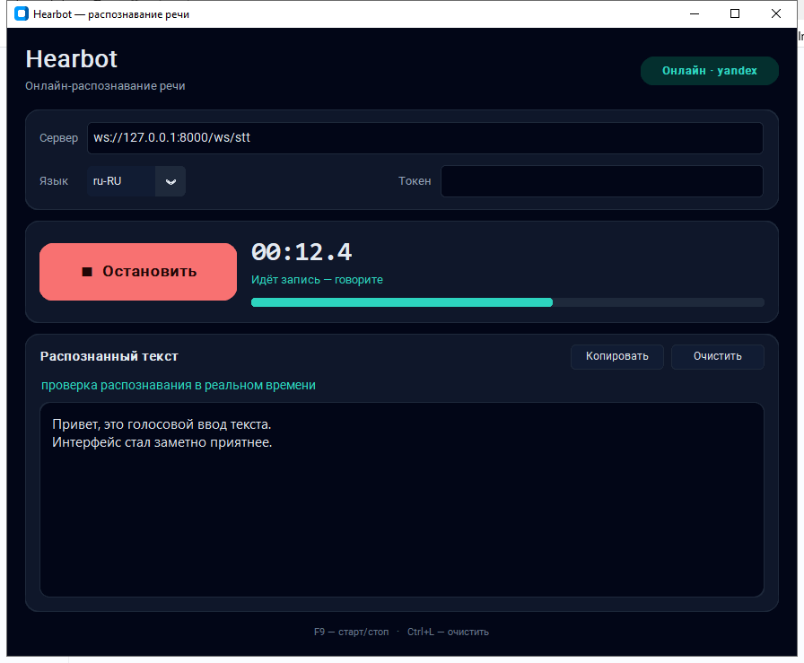
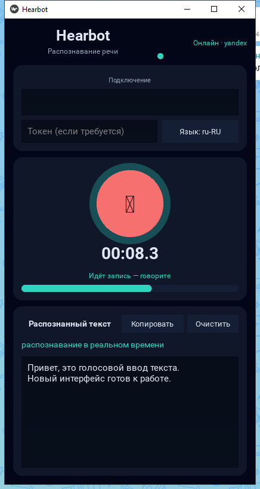

# Hearbot

Онлайн-распознавание речи для Windows и Android: лёгкий сервер на Python
(FastAPI + WebSocket) и два клиента, которые отправляют аудио с микрофона и
показывают распознанный текст в реальном времени.

## Возможности

- **Потоковая передача аудио** по WebSocket: PCM 16-bit, mono, 16 кГц.
- **Сменные провайдеры STT**: `dummy` (для разработки без ключей) и
  `yandex` (Yandex SpeechKit, есть бесплатный тариф).
- **Клиент Windows**: customtkinter + PyAudio, тёмный интерфейс в стиле панели
  управления: статус связи, таймер записи, индикатор уровня микрофона,
  живой текст и горячие клавиши.
- **Клиент Android**: Kivy + `android.media.AudioRecord`, собирается в APK;
  круглая кнопка записи с пульсацией, таймер и уровень микрофона.
- **Веб-панель `/admin`**: мониторинг клиентов, живая лента событий,
  удалённый старт/стоп записи и отключение клиентов.
- Конфигурация через переменные окружения / `.env`.

## Скриншоты

| Windows-клиент | Android-клиент |
|----------------|----------------|
|  |  |

## Структура репозитория

```
hearbot/
├── server/                  # FastAPI-сервер
│   ├── main.py              # WebSocket /ws/stt, /health, /admin
│   ├── config.py            # настройки из окружения
│   ├── manager.py           # реестр клиентов, метрики, команды управления
│   ├── admin_api.py         # REST API панели: /api/state, /api/clients
│   ├── static/
│   │   └── dashboard.html   # веб-панель мониторинга
│   └── stt/                 # провайдеры распознавания
│       ├── base.py          # интерфейс STTProvider
│       ├── dummy.py         # заглушка
│       ├── yandex.py        # Yandex SpeechKit
│       └── factory.py       # выбор провайдера
├── clients/
│   ├── windows/main.py      # Windows-клиент (customtkinter + PyAudio)
│   └── android/             # Android-клиент (Kivy)
│       ├── main.py
│       └── buildozer.spec
├── docs/
│   ├── ARCHITECTURE.md
│   ├── PROTOCOL.md
│   └── screenshots/         # снимки интерфейсов клиентов
├── tests/test_server.py
├── requirements.txt
└── .env.example
```

## Быстрый старт

### 1. Сервер

```powershell
python -m venv .venv
.venv\Scripts\activate
pip install -r requirements.txt
copy .env.example .env
python -m server.main
```

Сервер поднимется на `http://0.0.0.0:8000`. Проверка:

```powershell
curl http://127.0.0.1:8000/health
```

По умолчанию используется провайдер `dummy` — он не распознаёт речь, но
показывает длительность полученного аудио. Этого достаточно, чтобы проверить
клиентов и протокол.

### 2. Клиент Windows

```powershell
pip install -r clients/windows/requirements.txt
python clients/windows/main.py
```

В окне укажите адрес сервера (`ws://127.0.0.1:8000/ws/stt`), выберите язык и
нажмите «Начать запись». Пока идёт запись, слева виден таймер и индикатор
уровня микрофона; после остановки сервер вернёт распознанный текст.

Возможности окна:

- индикатор состояния: «Не подключён» / «Подключение…» / «Онлайн · provider»;
- таймер реплики и полоса уровня микрофона;
- область текста с кнопками **Копировать** и **Очистить**;
- горячие клавиши: **F9** — старт/стоп записи, **Ctrl+L** — очистить текст.

Интерфейс оформлен в тёмной теме, совпадающей с веб-панелью `/admin`.

### 3. Клиент Android

Сборка APK выполняется через [Buildozer](https://buildozer.readthedocs.io/).
Удобнее всего на Linux или в WSL/Docker (на Windows нативно сборка не
поддерживается):

```bash
cd clients/android
pip install buildozer cython
buildozer -v android debug
```

Полученный APK — в `clients/android/bin/`.

Интерфейс приложения: индикатор связи с сервером, поле адреса и токена,
переключатель языка, круглая кнопка записи с пульсирующим кольцом, таймер и
уровень микрофона, а также область распознанного текста с кнопками
**Копировать** и **Очистить**.

На реальном устройстве замените адрес сервера на IP компьютера в локальной
сети, например `ws://192.168.1.10:8000/ws/stt`, и разрешите входящие
подключения к порту 8000 в брандмауэре.

### 4. Панель управления

Откройте **http://127.0.0.1:8000/admin** (корень `/` перенаправляет туда же).

Что есть на панели:

- карточки подключённых клиентов: платформа, ID, IP, язык, время работы,
  длительность отправленного аудио, последний распознанный текст;
- живая лента событий: подключения, отключения, распознанные реплики, ошибки;
- статистика: клиенты онлайн, число реплик, минуты аудио, ошибки;
- кнопки **Старт** / **Стоп** — удалённо управляют записью микрофона клиента;
- кнопка **Отключить** — закрывает WebSocket-сессию клиента.

Панель обновляется раз в секунду. Чтобы закрыть доступ паролем, задайте в
`.env`:

```ini
HEARBOT_ADMIN_TOKEN=секретный_токен
```

После перезапуска сервера панель попросит токен и будет отправлять его в
заголовке `X-Admin-Token`.

## Подключение Yandex SpeechKit

Ключ можно выпустить в [AI Studio](https://aistudio.yandex.ru/) — это удобнее
всего: при создании ключа платформа сама создаёт сервисный аккаунт с ролью
`ai.editor` и выдаёт ключу нужные области действия.

1. Откройте нужный каталог в [AI Studio](https://aistudio.yandex.ru/).
2. Нажмите **Создать API-ключ** и сохраните секретную часть ключа.
3. Заполните `.env`:

```ini
STT_PROVIDER=yandex
YANDEX_API_KEY=ваш_api_ключ
YANDEX_FOLDER_ID=идентификатор_каталога
STT_LANGUAGE=ru-RU
```

4. Перезапустите сервер.

При ручной настройке в консоли Yandex Cloud создайте сервисный аккаунт с
ролью `ai.speechkit-stt.user` (или `ai.editor`), выпустите для него API-ключ
с областью действия `yc.ai.speechkitStt.execute` и укажите его каталог в
`YANDEX_FOLDER_ID`.

### Если SpeechKit отвечает 401/403 «PermissionDenied»

Ключ распознан, но у сервисного аккаунта нет прав на каталог. Проверьте:

- в AI Studio → **Доступ** → **Права доступа** у сервисного аккаунта,
  к которому привязан ключ, есть роль `ai.speechkit-stt.user` или `ai.editor`;
- у API-ключа есть область действия `yc.ai.speechkitStt.execute` (области
  действия задаются при создании и не меняются — при необходимости создайте
  новый ключ);
- `YANDEX_FOLDER_ID` — это каталог, в котором выпущен ключ, а не его имя.

Быстрый способ всё исправить — нажать **Создать API-ключ** в нужном каталоге
AI Studio и заменить ключ в `.env`.

> Бесплатный тариф Yandex SpeechKit ограничен. Провайдер отправляет в облако
> **каждую реплику целиком**, поэтому тишину лучше не записывать: нажимайте
> «Остановить» сразу после фразы. Поддержка VAD и потоковых частичных
> результатов — в планах (см. `docs/ARCHITECTURE.md`).

## Протокол

Подробное описание — в [docs/PROTOCOL.md](docs/PROTOCOL.md). Кратко:

| Направление | Сообщение | Описание |
|-------------|-----------|----------|
| клиент → сервер | бинарный чанк | PCM s16le, mono, 16 кГц |
| клиент → сервер | `{"type": "stop"}` | завершить реплику |
| сервер → клиент | `{"type": "ready", ...}` | сессия готова |
| сервер → клиент | `{"type": "final", "text": "..."}` | результат распознавания |
| сервер → клиент | `{"type": "error", "message": "..."}` | ошибка |
| сервер → клиент | `{"type": "control", "action": "..."}` | старт/стоп записи с панели |

Клиенты передают платформу в query-параметре `platform=windows|android` —
она отображается в панели управления.

## Тесты

```powershell
pip install -r requirements-dev.txt
pytest
```

Тесты используют провайдер `dummy` и не требуют облачных ключей.

## Ограничения текущей версии

- Yandex-провайдер возвращает только финальный текст (REST API v1).
- Нет автоматического определения речи (VAD) — аудио отправляется всё время записи.
- Аутентификация простая: общий токен в query-параметре; панель — общий
  админ-токен (для продакшена нужен JWT/OAuth).
- Аудио реплики хранится в памяти сервера; лимит — `MAX_UTTERANCE_SECONDS`.

## Лицензия

MIT, см. [LICENSE](LICENSE).
